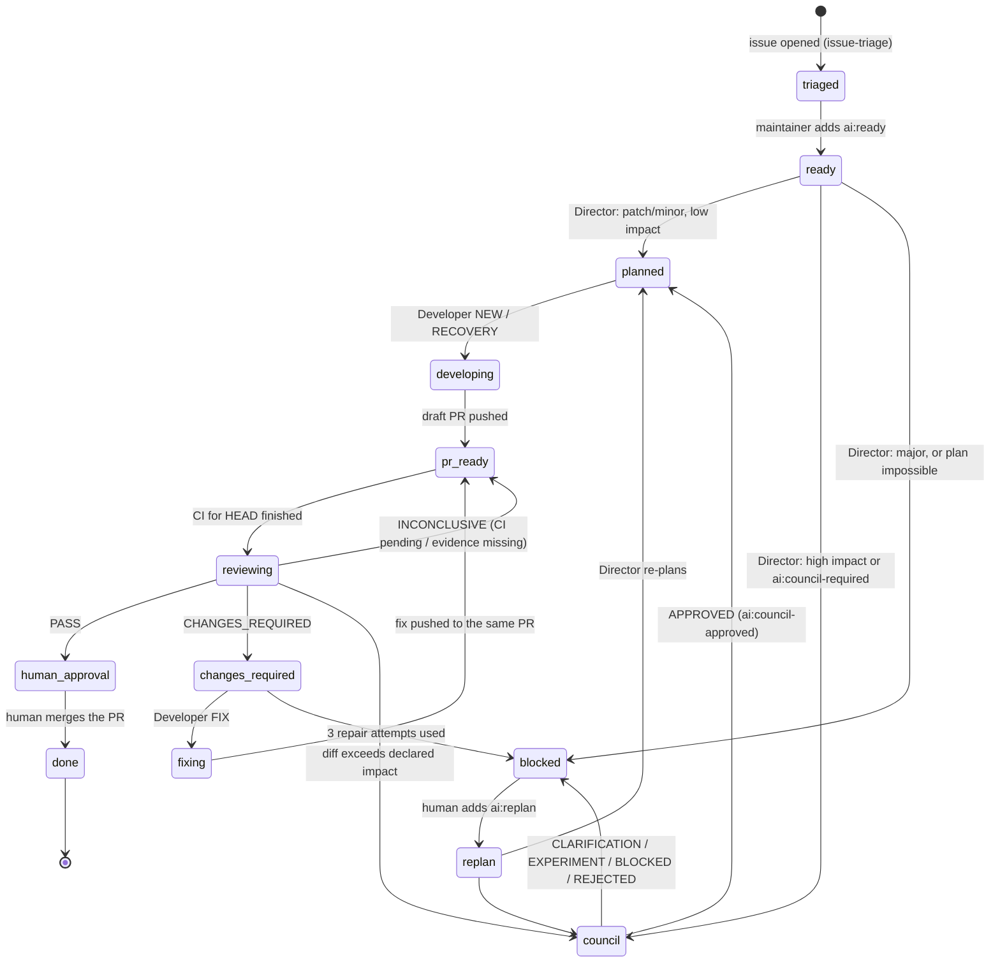
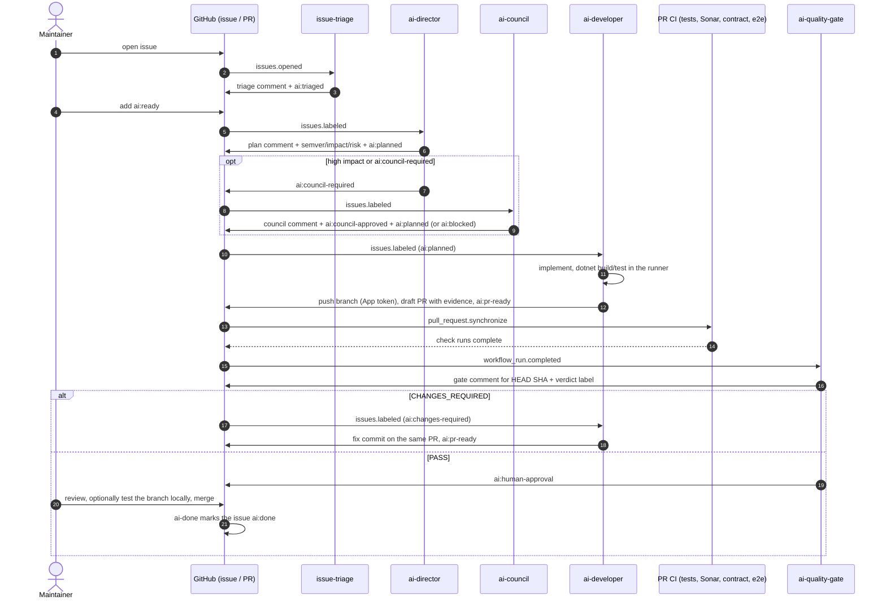

# AI Engineering Pipeline (CI, Cursor API)

> **Status: proposed design — not implemented yet.** This page is the target contract for moving
> the four autonomous-engineering routines (Engineering Director, Architecture Council, Autonomous
> Developer, Quality Gate) from local Claude routines into GitHub Actions, driven by the Cursor CLI
> and the `CURSOR_API_KEY` that [issue triage](../ai-capabilities.md#6-github-and-git) already uses.
> Each section says what exists today and what the rollout adds. When something is built, update
> this page in the same PR and move it out of "proposed".

## 1. What it is, in one paragraph

An issue moves through a fixed set of `ai:*` labels. Every label change is a trigger: a workflow
runs one role, the role's Cursor agent reads the repository and answers with a JSON result, and a
trusted script — never the agent — validates that result and writes to GitHub (comments, labels,
branches, PRs). Low-impact patch and minor work is implemented by the AI and lands as a **draft
PR**; high-impact minor work first goes through the Agent Council; breaking (major) work is never
implemented by the AI. **Nothing is ever merged or deployed by the pipeline** — a human reviews
every PR, and everything they need to judge it (classification, council decision, what ran, what
was skipped, how to test it locally) is in the PR body.

## 2. Roles

| Role | Prompt (CI copy) | Runs when | Agent may | Agent may not | Trusted writer does |
|---|---|---|---|---|---|
| Issue Triage *(exists)* | [`.github/triage/TRIAGE.md`](../../.github/triage/TRIAGE.md) | issue opened / edited / reopened | read the code | shell, write, network, GitHub | sticky triage comment, kind / area / priority labels, `ai:triaged` |
| Engineering Director | `.github/ai/director.md` | `ai:ready` or `ai:replan` added | read the code | shell, write, network, GitHub | one plan comment (`<!-- ai-director-plan:v1 -->`), classification labels, next state |
| Architecture Council | `.github/ai/council.md` | `ai:council-required` added; hourly sweep | read the code and the plan | shell, write, network, GitHub | one council comment (`<!-- ai-council:v1 -->`) carrying the log row, next state |
| Autonomous Developer | `.github/ai/developer.md` | `ai:planned` (NEW / RECOVERY) or `ai:changes-required` (FIX) added | read and edit the working tree, run `dotnet build` / `dotnet test` | network, GitHub, `.github/**`, analyzer / Sonar / threshold settings, deleting tests | diff policy check, commit, push with the App token, open or update the **draft** PR, PR body evidence, next state |
| Quality Gate | `.github/ai/quality-gate.md` | CI for the PR head finished (`workflow_run`), PR marked ready, manual run | read the PR diff, the code, CI and Sonar evidence handed to it | shell, write, network, GitHub | one gate comment (`<!-- ai-quality-gate:v1 -->`), verdict labels on the linked issue |

The prompts are the four routine files (Director, Council, Developer, Quality Gate) adapted to CI:
the agent no longer calls GitHub itself, it returns a JSON object whose schema is in the prompt,
and the matching `scripts/ai/<role>/apply.mjs` performs every write.

**Director in CI** ([`ai-director.yml`](../../.github/workflows/ai-director.yml),
[`scripts/ai/director/`](../../scripts/ai/director/), core in
[`scripts/ai/lib/director.mjs`](../../scripts/ai/lib/director.mjs)). Before the agent runs, the
collector decides three of the routine's states without it: an open linked PR → `active-pr` (nothing
is planned); an earlier plan comment whose classification still parses and no `ai:replan` →
`reuse` (apply mode restores its labels, no comment, no agent run); otherwise → `plan`. Only
`plan` starts the agent, so the hourly sweep does not re-plan the same issue. After the agent, the
writer re-checks the planned component paths against `.github/ai/impact-paths.json` — each rule
carries the §3 criterion it proves, and a match can only **raise** the impact — then picks the next
state: `ai:blocked` (major, a `.github/` change, already resolved, needs info, or a human
`ai:blocked` without `ai:replan`), `ai:council-required` (a council criterion or a maintainer's
request), else `ai:planned`. In `dry-run` the plan comment shows the labels it *would* set.

**Council in CI** ([`ai-council.yml`](../../.github/workflows/ai-council.yml),
[`scripts/ai/council/`](../../scripts/ai/council/), core in
[`scripts/ai/lib/council.mjs`](../../scripts/ai/lib/council.mjs)). One agent run plays the council:
it selects the roles by [COUNCIL-SELECTION](../agent-council/COUNCIL-SELECTION.md), writes each
position independently, one objection round, at least two approaches, conditions, dissent. Before
it runs, the collector leaves alone an issue that is `ai:blocked` or already `ai:council-approved`,
skips one whose input (issue text, Director plan, human comments, semver / impact labels) has the
same fingerprint as the last council comment, and answers an issue with no Director plan without
the agent. After it, the writer can only make the verdict **stricter**: an approval with a
human-owned condition or decision becomes `APPROVE_WITH_CONDITIONS`, a low-confidence approval or
one missing a core role becomes `CLARIFICATION_REQUIRED`, a major change is `BLOCKED`; a missing
answer is `INCONCLUSIVE` (no label change, retried by the sweep). The hourly sweep exists because
the Director cannot re-trigger the council when `ai:council-required` is already on the issue.

**No branch-prefix filter.** The Quality Gate reviews **every open PR** that targets `master` or a
`release-v*` line, not only `claude/*` branches. What changes with the PR's origin is what the
gate may *write* (§8).

## 3. Change classification and guard matrix

The Director classifies every planned issue on two axes and writes both as labels.

**Change level** — `ai:semver-patch` (fix, no contract change) · `ai:semver-minor` (new,
backward-compatible capability) · `ai:semver-major` (anything breaking: removed or renamed field,
changed default, changed response shape without a version bump).

**Impact** — `ai:impact-low` or `ai:impact-high`. Impact is **high** when any of these holds:

- touches authorization, authentication, secrets, encryption or the script sandbox;
- adds or changes a database migration or a persisted shape;
- changes a public API, event contract, state-function body or `ResponseShapeVersion`;
- changes a core process: pipeline / `LifecycleOrder`, transitions, subflows, locking, instance
  data, error boundary, state function, outbox / inbox / relays;
- needs a companion **contract** change in another product (vnext-schema, vnext-helm-charts,
  vnext-workflow-cli, vnext-forge). A companion test suite in vnext-example or a vnext-docs page
  does not raise impact on its own.

| Level | Impact | Council | Development | Human |
|---|---|---|---|---|
| patch / minor | low | none | AI implements, opens a **draft PR** | reviews and merges |
| minor | high | **when a trigger fires** (below) — before development | AI implements only after an `APPROVED` council verdict | sees the council decision and every skipped check in the PR; may pull the branch and test locally |
| patch | high | same as minor / high | same as minor / high | same |
| major | any | — | **never by AI** — `ai:blocked` | decides; breaking changes are avoided — the old shape stays supported in parallel and gets a deprecation + migration entry ([`contract/api-breaking`](../code-review/reviewers/contract.md#1-public-api-compatibility-contractapi-)) |

**Council triggers** (any one): the Director's high-impact checklist above fires on auth/security,
migration, contract or distributed-consistency; a maintainer adds `ai:council-required`; the
Quality Gate finds the PR's diff exceeds the declared impact (§7.3).

**Council outcome**

| Verdict | Next state |
|---|---|
| `APPROVED` (only developer-owned conditions, met inside the PR) | `ai:council-approved` + `ai:planned` — the Developer starts |
| `APPROVE_WITH_CONDITIONS`, `CLARIFICATION_REQUIRED`, `EXPERIMENT_REQUIRED`, `BLOCKED`, `REJECTED` | `ai:blocked` — a human decides; once human conditions are met, a maintainer adds `ai:council-approved` + `ai:planned` |

In this pipeline a CI council `APPROVED` verdict **authorizes development**, not merge. The human
gate sits on the PR. This is a deliberate, scoped exception to the Chair-approval rule in
[Agent Council plan mode](../../.claude/rules/agent-council-plan-mode.md); that rule still governs
every council run outside this pipeline. The council comment is the session record; it carries the
row for [sessions/README.md](../agent-council/sessions/README.md), which the Developer's PR appends
(master takes no direct pushes), or the maintainer who decides a blocked verdict.

Risk labels used by the original routines map onto this matrix so the prompts keep working:
`ai:risk-low` = patch / low · `ai:risk-medium` = minor / low · `ai:risk-high` = any / high ·
`ai:risk-critical` = major. The Director writes exactly one.

## 4. Label taxonomy

All labels live in [`.github/triage/labels.json`](../../.github/triage/labels.json) and are created
with `node scripts/triage/sync-labels.mjs --apply` (it never deletes a label).

| Group | Labels | Set by |
|---|---|---|
| Workflow state (exactly one) | `ai:triaged` · `ai:ready` · `ai:replan` · `ai:planned` · `ai:developing` · `ai:pr-ready` · `ai:reviewing` · `ai:changes-required` · `ai:fixing` · `ai:human-approval` · `ai:blocked` · `ai:done` | pipeline; `ai:ready`, `ai:replan`, `ai:blocked` also by a human |
| Change level (one) | `ai:semver-patch` · `ai:semver-minor` · `ai:semver-major` | Director |
| Impact (one) | `ai:impact-low` · `ai:impact-high` | Director; raised by the Quality Gate |
| Risk (one, derived) | `ai:risk-low` · `ai:risk-medium` · `ai:risk-high` · `ai:risk-critical` | Director |
| Council | `ai:council-required` · `ai:council-approved` | Director, human; council writer |
| Deprecated | `ai:in-progress` → `ai:developing` · `ai:pr-opened` → `ai:pr-ready` · `ai:needs-human` → `ai:blocked` | nobody; kept for old issues |

In `labels.json` each row of this table is its own group: `status`, `changeLevel`, `impact`, `risk`,
`council`, `deprecated` (beside the triage groups `kinds`, `areas`, `priorities`). A deprecated entry
carries `replacedBy`; the pipeline never sets it, and the issue keeps it until a human removes it.
`scripts/triage/test/labels.test.mjs` pins the groups to this table — change both together.

**Rules a human can rely on**

- `ai:blocked` set by a human is never removed by the pipeline.
- Removing `ai:ready` / `ai:planned` before a run starts cancels it (each workflow re-reads the
  labels first).
- Adding `ai:replan` sends any issue back to the Director; adding `ai:council-required` forces the
  council path regardless of the Director's classification.

## 5. State machine



`council`, `pr_ready`, `human_approval`, `changes_required` stand for the labels
`ai:council-required`, `ai:pr-ready`, `ai:human-approval`, `ai:changes-required`.

## 6. End-to-end sequence



## 7. Workflows and triggers

| Workflow | Event | Filter | Concurrency |
|---|---|---|---|
| `issue-triage.yml` *(exists)* | `issues: opened, edited, reopened`, manual | author not a bot | per issue |
| `ai-director.yml` *(dry-run)* | `issues: labeled`, hourly sweep (at most 3 issues, `ai:replan` first), manual | label is `ai:ready` / `ai:replan`; issue open | per issue |
| `ai-council.yml` *(dry-run)* | `issues: labeled`, hourly sweep (at most 2 issues whose input changed), manual (`issue`, `force`) | label is `ai:council-required`; issue open | per issue |
| `ai-developer.yml` | `issues: labeled`, manual | label is `ai:planned` / `ai:changes-required`; not `ai:blocked`, `ai:done`, `ai:human-approval`, `ai:semver-major`; with `ai:council-required` also `ai:council-approved` | per issue, never cancelled mid-push |
| `ai-quality-gate.yml` *(dry-run)* | `workflow_run: completed` of `Unit Tests`, `SonarQube`, `PR Contract`; hourly sweep (2 PRs whose evidence changed); manual (`pr`, `force`) | PR open; base `master` / `release-v*` (`.github/ai/gate.json`) | per HEAD SHA, latest wins |
| `ai-done.yml` | `pull_request: closed` | merged; linked issue carries an `ai:*` state | per issue |

### 7.1 Why labels are written with the GitHub App token

GitHub does not start a workflow for events caused by `GITHUB_TOKEN` (a loop guard). If the
Director added `ai:planned` with `GITHUB_TOKEN`, the Developer would never run. Every write that
must trigger the next role uses the GitHub App installation token (`APP_ID` / `APP_PRIVATE_KEY`,
already configured for triage), generated **after** the agent has finished, so the agent never
holds it.

The same App also serves the release workflows, so its installation may hold more permissions than
the pipeline needs. Every `ai-*.yml` workflow therefore **down-scopes** the token it mints with
`permission-*` inputs on `actions/create-github-app-token` — only `contents`, `issues`,
`pull-requests` (and read-only `checks`, `statuses`, `actions`, `metadata`), never `workflows`,
`administration` or `secrets`. A token without `workflows` makes GitHub refuse any push that edits
`.github/workflows/`, a second guard on top of the diff policy.
[`ai-workflows.test.mjs`](../../scripts/governance/test/ai-workflows.test.mjs) fails the PR
Contract workflow when an `ai-*.yml` mints a token without `permission-*` inputs or with a forbidden one.

### 7.2 Why the Quality Gate runs on `workflow_run`

`workflow_run` runs the workflow file from the default branch with secrets, also for PRs from
forks; the PR's code is checked out read-only and never executed by the gate. `pull_request_target`
is not used: it is the common way to leak secrets to PR code.

### 7.3 Re-checking the declared classification

The agent's "patch / low impact" is a claim. The path rules in
[`.github/ai/impact-paths.json`](../../.github/ai/impact-paths.json) list what makes a change high
impact: migrations, `Authorization/`, `Security/` / `Encryption/` / `Masking/`, the script sandbox,
controllers and application contracts / DTOs, `Events.Contracts`, task abstractions,
`LifecycleOrder.cs` / `PipelineExecutionProfile.cs` / `PipelineProfileResolver.cs`,
`StateFunctionCache.cs`, Dapr components and anything under `.github/`. Two checks read it:

- the PR contract (`PR-AI-IMPACT`) flags an `ai:impact-low` PR whose diff matches a rule — on every
  push, so the Developer sees it before review;
- the Quality Gate's trusted script does not PASS such a PR: it sets `ai:impact-high` +
  `ai:council-required` and explains which rule matched.

Helm values live in vnext-helm-charts, outside this diff; a change that needs them is high impact
through the companion-contract criterion (§3). A test fails when a rule stops matching any tracked
file, so a moved directory cannot silently disable it.

## 8. Quality Gate

Evidence is read separately and never inferred from one another: **build**, **unit tests**,
**coverage**, **Sonar**, **security scan**, **PR contract**, **e2e**.

| Verdict | When | Writes |
|---|---|---|
| `PASS` | build and unit tests passed for the HEAD SHA; no blocking review, Sonar or security finding (Sonar new-code coverage alone is recorded as `COVERAGE_WARNING`); PR contract green; classification matches the diff | `ai:human-approval`; removes `ai:pr-ready`, `ai:reviewing`, `ai:fixing`, `ai:changes-required` |
| `CHANGES_REQUIRED` | a confirmed defect, failing build or test, blocking finding, acceptance criterion missed | `ai:changes-required` + exact repair instructions; removes conflicting states |
| `INCONCLUSIVE` | required CI still running, or required evidence missing | keeps `ai:pr-ready`; records what is missing |

**PRs not created by the pipeline** (no linked issue in an `ai:*` state, e.g. a human PR) get the
same review comment, but the gate changes **no labels** and never triggers the Developer.

**How it is built** ([`ai-quality-gate.yml`](../../.github/workflows/ai-quality-gate.yml),
[`scripts/ai/gate/`](../../scripts/ai/gate/), core [`scripts/ai/lib/gate.mjs`](../../scripts/ai/lib/gate.mjs),
evidence list [`.github/ai/gate.json`](../../.github/ai/gate.json)):

1. The trusted collector reads, for the PR's HEAD SHA: the check runs (latest re-run per name),
   commit statuses, the SonarCloud gate and its new-code bugs / vulnerabilities (`SONAR_TOKEN`),
   the `PR-*` annotations of the `pr-contract` run, the linked issue and its Director plan.
2. It evaluates that evidence **itself**: a required check missing or running → `INCONCLUSIVE`
   (no agent run); a failed one blocks; a failed Sonar gate whose only failed conditions are
   new-code coverage → `COVERAGE_WARNING`; a failed Sonar gate it cannot read → `INCONCLUSIVE`;
   a `PR-AI-*` contract finding blocks a pipeline PR and only warns on a human PR; an
   `ai:impact-low` pipeline PR whose diff matches `.github/ai/impact-paths.json` → `COUNCIL`
   (no agent run; the issue gets `ai:impact-high` + `ai:council-required`).
3. Only when the evidence is complete does the agent review the diff. Its findings can only add
   to what blocks — a `blocking` finding or an unmet acceptance criterion gives `CHANGES_REQUIRED` —
   and a missing or unusable review is `INCONCLUSIVE`, never `PASS`.
4. After `AI_MAX_REPAIRS` distinct SHAs needed changes, `CHANGES_REQUIRED` becomes `ai:blocked`.

`workflow_run` runs the gate from the default branch with secrets (§7.2). The tooling and the
prompt come from that checkout; the PR's HEAD is fetched into a separate folder that the agent only
reads — nothing from the PR is built or executed, and an agent that changes the folder has its review
discarded. A PR opened before a required check existed (for example before `Unit Tests`) stays
`INCONCLUSIVE` until a push or a re-run produces that check for its HEAD.

**Idempotency** — one comment per PR, found by `<!-- ai-quality-gate:v1 -->`. A hidden fingerprint
in it (HEAD SHA, check names and conclusions, test status, Sonar and security findings, verdict,
repair attempt count) decides whether anything changed; unchanged → no write.

**Unit tests** — every failing unit test blocks, with no pre-existing-failure exception: the suite
is kept green ([Unit Tests: Always Green](../testing/unit-tests.md)). A red the PR did not cause is
still `CHANGES_REQUIRED`; the Developer fixes it in the same repair loop.

## 9. The AI PR body — what the human gets

The Developer writes the body from [the PR template](../../.github/PULL_REQUEST_TEMPLATE.md) and
adds one section. [`pr-contract.mjs`](../../scripts/governance/pr-contract.mjs) enforces it on every
PR that carries an `ai:` label (the trusted writer labels the PR as it labels the issue), on light
and full tiers alike — rule ids `PR-AI-*` in the
[evidence reviewer §4](../code-review/reviewers/evidence.md#4-pr-body-evidence-evidencepr-).

```markdown
## AI decision record
- Issue: #<n> · Director plan: <link to the plan comment>
- Classification: semver-<patch|minor> · impact-<low|high> · risk-<…>
  - Why: <one line per triggered criterion, or "no high-impact criterion matched">
- Council: <not required — reason> | <verdict, session link, dissent, conditions and their status>
- Repair attempts: <n>/3

### Done / skipped
| Check | Status | Note |
|---|---|---|
| Build (runner) | run / not-run | |
| Unit tests (runner) | run / not-run | which projects / filters |
| Unit tests (CI) | see checks | |
| E2E (vnext-example) | run / not-run | suites, or why not |
| Observability verification | not-run | no infra in CI — must be done locally if the change is timing / trace related |
| Companion PRs | <links> | from the Product impact table |

### Test it locally
    git fetch origin <branch> && git switch <branch>
    ./scripts/setup-netstandard-ref.sh && dotnet build
    cd etc/docker && ./run-docker.sh up core
    cd ../vnext-example && dotnet test tests/Core.IntegrationTests --filter "<suites>"
- Expected behaviour: <what to look for>
```

The existing **Product impact** table of the template is where the Developer declares every other
product the change needs (vnext-schema, vnext-docs, vnext-example, helm, …); a `yes` row must link
the companion PR or the `docs/integration/` handoff (§10.3) — for vnext-docs always the handoff.

## 10. E2E and companion products

### 10.1 Today

Locally a developer runs vnext-example's `tests/Core.IntegrationTests` (one project, 38 suite
folders, one folder = one `--filter "FullyQualifiedName~<Suite>"`) against the runtime built from
the working tree, renders the TRX with
[`e2e-evidence.mjs`](../../scripts/governance/e2e-evidence.mjs) and pastes the block into the PR's
`## E2E evidence`; [PR Contract](../../.github/workflows/pr-contract.yml) checks it (`PR-E2E-STATUS`,
and `PR-E2E-RUN`: the runtime SHA must be a commit of the PR). No CI job runs these tests: the
vnext-example workflows only run `npm` validation.

### 10.2 The CI job (`pr-e2e.yml`)

It follows the [integration-testing policy](../testing/integration-testing.md): the runtime is
**built from the PR checkout**, never pulled as an image. The SDK's Testcontainers mode and the
`pr-prerelease-images` ghcr images are therefore not used (they would also need an SDK code change
for the tag, lack the system package, and fail AccountOpening by design).

```mermaid
flowchart LR
    A[checkout vnext @ PR head] --> B[checkout vnext-example<br/>companion branch or master]
    B --> C[setup .NET 10 + setup-netstandard-ref.sh]
    C --> D["run-docker.sh up core<br/>(non-interactive, waits for /health)"]
    D --> E[init: POST /api/package/runtime/publish<br/>poll statusUrl until completed]
    E --> F[MockLab compose<br/>bbt-development network + warm-up]
    F --> G["dotnet test Core.IntegrationTests<br/>--filter suites · --blame-hang · TRX"]
    G --> H[e2e-evidence.mjs<br/>runtime SHA = PR head]
    H --> I[artifact + sticky comment<br/>AI PR: body section]
```



| Topic | Decision |
|---|---|
| Event | `pull_request` (`synchronize`, `ready_for_review`, `labeled`). The job needs **no secret**, so it is safe for fork PRs too; only the step that writes the result uses a token, in a separate `workflow_run` job |
| When | AI PRs always; human PRs when `vNext scope` names a core process or the `e2e` label is set; the full set nightly on master and with label `e2e:full` |
| Which suites | the Developer lists them in the plan / PR (`e2eSuites`), derived from the areas it touched and the TEST-SCENARIOS §2 table; the gate checks that a core-process change ran at least the suites of its areas |
| Runtime URL | `VNEXT_BASE_URL=http://localhost:4201` — the committed `test.runsettings` already points there, so external mode works unchanged |
| Duration | last measured full core run 5 min 30 s (411 tests: 377 passed, 34 skipped) plus a cold build and start; target job timeout 45 min |
| Known reds | a cold MockLab fails the FanOut tests on the first run → a warm-up step; the known-red list from TEST-SCENARIOS "Koşum Öncesi Kontrol" is passed to `e2e-evidence.mjs --reds` and not counted as a regression |
| Not covered | cross-domain lab (core + partner + credit + discovery), MorphIdm and ScriptPluginLab (SQL Server) suites — they skip and the evidence says so; a later phase runs the cross-domain lab nightly |
| Observability | no MCP servers in CI → the evidence is labelled "not confirmed against traces"; timing / trace claims stay a local check (§9) |

The Quality Gate reads the e2e result as its own evidence line: a new red blocks, a skipped suite
is listed, a missing run on a core-process change is `INCONCLUSIVE`.

### 10.3 Companion products

The PR template's **Product impact** table already lists every product a runtime change can touch.
For an AI PR each `yes` row becomes a companion PR opened by the Developer's writer in that
repository, as a **draft**, on a branch with **the same name** as the vnext branch, linked both ways:

| Product | What the Developer adds | Its CI |
|---|---|---|
| vnext-example | the new suite in one commit: flow, test class, scenario README, TEST-SCENARIOS §2 row and index | none for .NET tests — `pr-e2e.yml` in vnext checks out the same-named branch, so the new suite runs against the PR's runtime |
| vnext-schema | the schema change | `npm run test:coverage` + `validate`; must be released **before** the runtime PR merges |
| vnext-helm-charts | new config / env | chart CI (path-filtered) |
| `docs/integration/<product>/` | a handoff spec, in this PR, for products the AI does not edit: **vnext-docs**, vnext-forge, vnext-workflow-cli, vnext-ai-toolkit | PR Contract |

**vnext-docs is never edited by the pipeline.** The product docs are released last and under human
control, so the Developer only marks `vnext-docs = yes` in the Product impact table and writes
what the docs must say to `docs/integration/vnext-docs/<slug>.md` in the vnext PR
([convention](../integration/README.md)). The docs team turns that handoff into the portal page at
release time.

The `AI decision record` lists the companion PRs and the **merge order** (for example schema →
vnext → example). Nothing is merged by the pipeline in any repository. Requirements: the GitHub
App is installed on those repositories with Contents and Pull requests write, and a companion
change of a contract product raises impact (§3).

## 11. Rollout

| Step | What | Done when |
|---|---|---|
| 0 | **Unit tests in CI, green.** `pr-tests.yml` runs on every PR and push to master and fails on any failing test; every pre-existing red is fixed (no known-red baseline), then the `Unit Tests` check becomes required ([policy](../testing/unit-tests.md)) | master has zero failing unit tests and the check is required |
| 1 | **Taxonomy.** Labels of §4 in `labels.json` (one group per row, pinned by `labels.test.mjs`), `sync-labels --apply`, deprecated labels documented | every label exists with a description |
| 2 | **Guards.** `PR-AI-*` rules in the PR contract (§9), the path rules in `.github/ai/impact-paths.json` (§7.3), down-scoped App tokens checked by `ai-workflows.test.mjs` (§7.1) | governance script tests pass |
| 3 | **Read-only roles** in `dry-run`, one PR per role: Director (`ai-director.yml`), Quality Gate (`ai-quality-gate.yml`), Council (`ai-council.yml`) — comments only | a week of runs with no wrong state |
| 4 | **Developer** in `dry-run` (pushes to a branch, opens a draft PR, no label transitions), then `apply` | first low-impact issue reaches `ai:human-approval` |
| 5 | **E2E in CI** (§10) | e2e evidence appears on AI PRs |
| 6 | `apply` for every role | — |

## 12. Configuration

| Name | Kind | Purpose |
|---|---|---|
| `CURSOR_API_KEY` | secret | Cursor CLI auth for every role; without it each workflow is a no-op |
| `APP_ID`, `APP_PRIVATE_KEY` | secret | GitHub App token for writes that must trigger the next role |
| `SONAR_TOKEN` | secret | Quality Gate reads Sonar findings for the PR |
| `AI_MODE` | variable | `dry-run` (comments only, default) / `apply` |
| `AI_DIRECTOR_MODEL`, `AI_COUNCIL_MODEL`, `AI_DEVELOPER_MODEL`, `AI_GATE_MODEL` | variable | per-role model override (`agent --list-models`) |
| `AI_MAX_REPAIRS` | variable | default `3` |
| `UNIT_TESTS_MODE` | variable | [`pr-tests.yml`](../../.github/workflows/pr-tests.yml): unset = `enforce` (any failure blocks); `report` is an emergency switch for a runner outage only |

## 13. Security model

- Issue and PR text is untrusted (public repository); the prompts say so and the output schema
  leaves no room for free-form instructions to the writer.
- No agent ever holds a GitHub token: checkout uses `persist-credentials: false`, the App token is
  generated after the agent step, and secrets are redacted from every comment the writer posts.
- Read-only roles run like triage: `--mode ask`, a deny list for shell / write / network / MCP, and
  a dirty working tree aborts the write step.
- The Developer runs with write and a shell allow-list (`dotnet build`, `dotnet test`); packages are
  restored **before** the agent step and the agent has no network. The writer rejects a diff that
  touches `.github/**`, Sonar / analyzer / coverage settings, `Directory.Build.props` warning
  levels, or deletes a test, and refuses to push otherwise.
- Nothing merges, deploys, changes thresholds or edits branch protection.

## 14. Day-to-day use

**Hand an issue to the AI** — make sure the triage comment is right, then add `ai:ready`. The plan
comment appears on the issue; if the classification is wrong, fix the labels and add `ai:replan`.

**Force or skip the council** — add `ai:council-required` to force it. Skipping it on a
high-impact change is not possible from a label; remove the impact label only if the classification
was wrong, and say so in a comment.

**Review an AI PR** — read the `AI decision record` first: classification, council, the done /
skipped table. Everything marked `not-run` is yours to judge; the *Test it locally* block has the
commands. Request changes in review comments as usual: the next Quality Gate run reads them as
actionable findings.

**Stop everything on an issue** — add `ai:blocked`. The pipeline never removes it; remove it and
add `ai:replan` to resume.

**After 3 failed repairs** — the issue is `ai:blocked` with a summary of the attempts. Fix by hand on
the same PR, or re-plan.

**Run a role by hand** — every workflow has `workflow_dispatch` with an issue or PR number.
