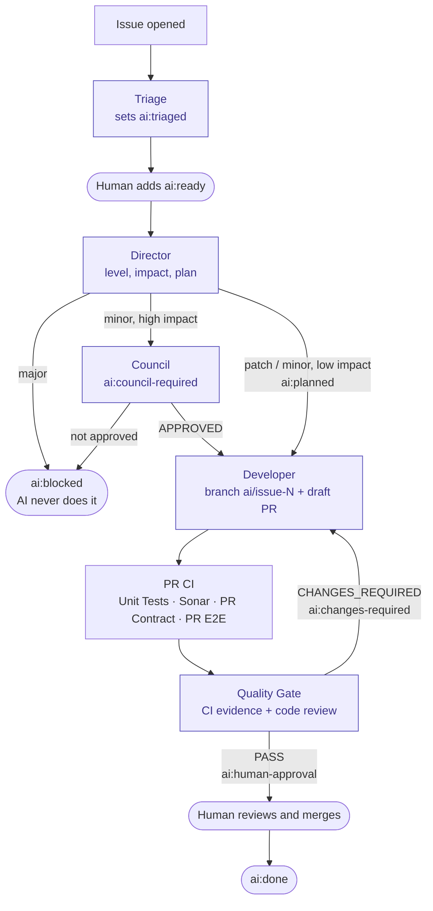

# AI Pipeline at a Glance

A one-page picture of the CI AI agents: which label starts which agent, and how an issue becomes a
merged PR. The contract behind it (guard matrix, security model, PR evidence, configuration) is
[AI engineering pipeline](ai-engineering-pipeline.md); when the two disagree, that page and the
workflows under `.github/workflows/` win.

## How it works

Each agent is a GitHub Actions workflow whose reasoning runs on the Cursor CLI. Agents never call one
another: an agent writes a **label** on the issue (or a check finishes on the PR), and that event
starts the next agent. A human acts twice — `ai:ready` to start, merge to finish.

Purple boxes are AI agents; rounded boxes are a human step or a terminal label.

## Which label triggers what

| Label / event | Set by | Starts | What it does |
|---|---|---|---|
| issue opened | human | **Triage** (`issue-triage.yml`) | summary, area / priority labels, `ai:triaged` |
| `ai:ready` | **human** | **Director** (`ai-director.yml`) | decides patch / minor / major, impact and risk; writes the plan |
| `ai:council-required` | Director | **Council** (`ai-council.yml`) | debates a high-impact minor change: `ai:planned`, or `ai:blocked` |
| `ai:planned` | Director or Council | **Developer** (`ai-developer.yml`) | writes the change, builds and tests in a sandbox, pushes `ai/issue-N`, opens a **draft** PR, sets `ai:pr-ready` |
| PR CI completed | GitHub | **Quality Gate** (`ai-quality-gate.yml`) | reads the CI evidence and reviews the diff: PASS, CHANGES_REQUIRED or INCONCLUSIVE |
| `ai:changes-required` | Quality Gate | **Developer** (FIX mode) | fixes the same PR; after 3 attempts the issue goes to `ai:blocked` |
| `ai:human-approval` | Quality Gate | — | a human reviews and merges; the issue becomes `ai:done` |
| `ai:replan` | human | Director | re-plans a blocked issue |
| `e2e` / `e2e:full` | human (non-AI PRs) | **PR E2E** (`pr-e2e.yml`) | runs vnext-example integration tests against the PR's runtime; AI PRs always run it |

## Step by step

1. An issue is opened; Triage enriches it and sets `ai:triaged`.
2. A maintainer decides the AI should do it and adds **`ai:ready`**.
3. The Director classifies it: patch or low-impact minor → `ai:planned`; high-impact minor → Council;
   major → `ai:blocked`.
4. The Developer implements it and opens a draft PR on `ai/issue-N`.
5. CI runs on the PR: Unit Tests, Sonar, PR Contract and PR E2E.
6. The Quality Gate decides: **PASS** → `ai:human-approval`; **CHANGES_REQUIRED** → the Developer
   fixes the same PR and CI runs again; **INCONCLUSIVE** → CI is still running, it looks again later.
7. A human reviews and merges.

## Guards worth remembering

- A **major** change is never done by the AI.
- No agent merges, deploys, changes a threshold or edits branch protection.
- An `ai:blocked` set by a human is never removed by the pipeline.
- The Developer pushes only to `ai/issue-<n>`, always as a draft PR, and never edits `.github/**`.

## Modes

The repository variable `AI_MODE` switches every role: `dry-run` (comments only; the Developer still
opens a draft PR but changes no issue label) or `apply` (labels are written and the chain advances on
its own). Setting it back to `dry-run` is the emergency brake.

## Status

| Date | State |
|---|---|
| 2026-11-11 | Rollout steps 0–5 done; `AI_MODE=apply` for every role (step 6). First issues are being watched; a role can be moved back to `dry-run` if it writes a wrong state. |
